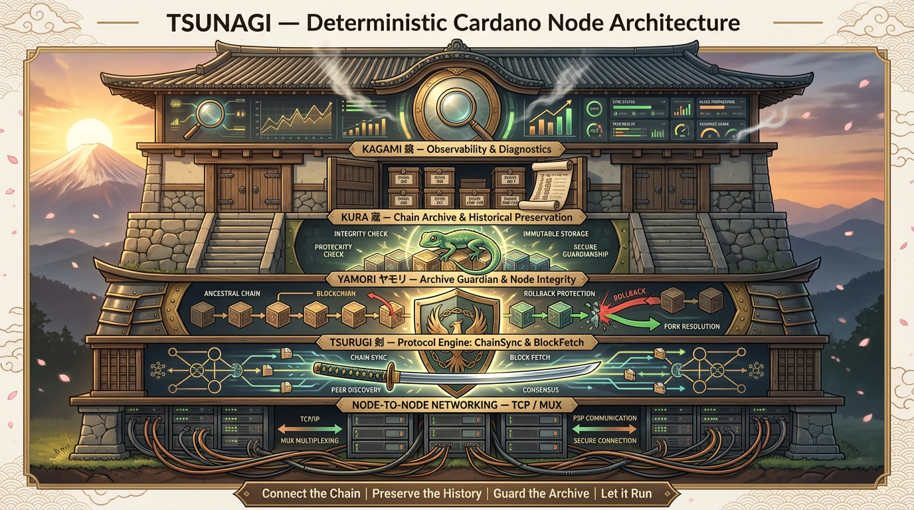

# TSUNAGI Layered Architecture

TSUNAGI is structured as a layered stack. Each layer has a distinct
responsibility and a Japanese-inspired name reflecting its role.

---

## Stack (top to bottom)

```
KAGAMI  鏡    Observability & Diagnostics
KURA    蔵    Historical Archive & Chain Storage
YAMORI  ヤモリ  Node Guardian & Integrity Monitor
TATE    盾    Rollback Resilience & Ancestry Defense
TSURUGI 剣    Protocol Engine: ChainSync & BlockFetch
NETWORK       Node-to-Node Networking — TCP / MUX
```

---

## Layer Descriptions

### KAGAMI 鏡 — Observability & Diagnostics

Mirror layer. Exposes internal state for monitoring, metrics, and
diagnostic tooling. Named for the mirror (鏡) that reflects truth.

### KURA 蔵 — Historical Archive & Chain Storage

Storage layer. Manages LMDB UTxO store, CBOR archive, slot-range
coverage tracking, and persistent chain state. Named for the
storehouse (蔵) that preserves value.

### YAMORI ヤモリ — Node Guardian & Integrity Monitor

Guardian layer. Watches over node health, manages seal-tip artifacts,
fragment integrity, and operator recovery. Named for the gecko
(ヤモリ) that guards the house.

### TATE 盾 — Rollback Resilience & Ancestry Defense

Defense layer. Handles undo stack management, rollback operations,
ancestry chain verification, and fork resilience. Named for the
shield (盾) that protects against chain reorganizations.

### TSURUGI 剣 — Protocol Engine: ChainSync & BlockFetch

Protocol layer. Implements the Ouroboros NodeToNode protocol:
ChainSync (tip tracking, intersection finding, header serving) and
BlockFetch (block request handling, batch serving). Named for the
sword (剣) that cuts through the protocol.

### Node-to-Node Networking — TCP / MUX

Transport layer. TCP connections, multiplexer framing, handshake
negotiation. The foundation upon which all protocol communication
is built.

---

## Motto

> Connect the Chain | Preserve the History | Guard the Archive | Let it Run

---

## Architecture Diagrams

### Node Architecture


